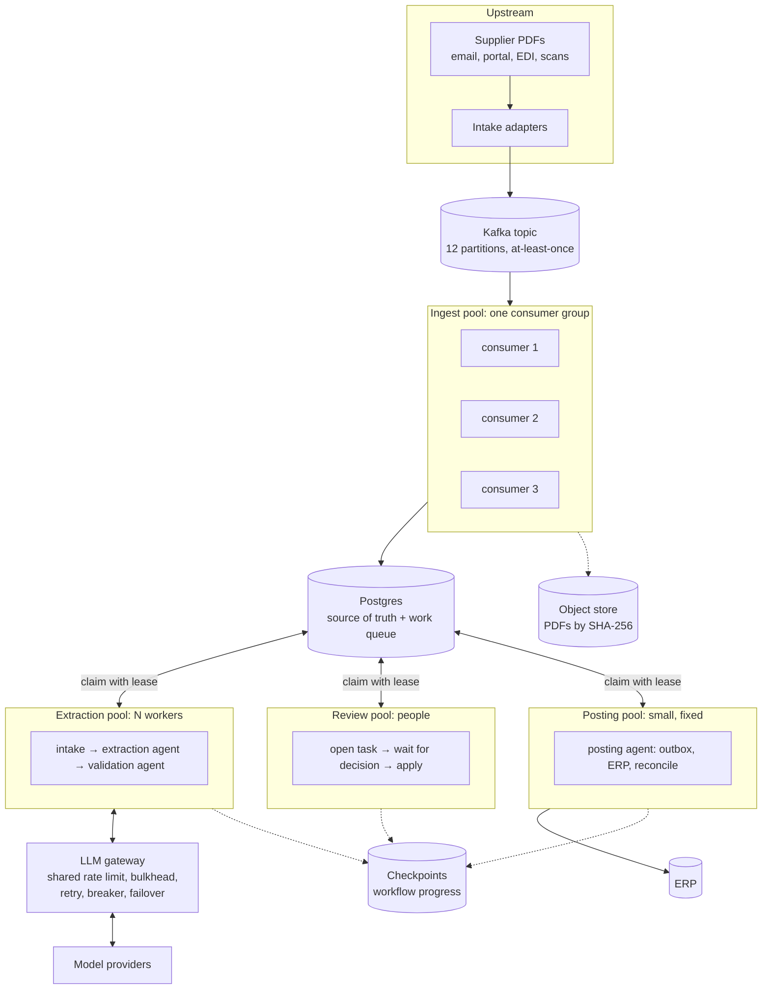
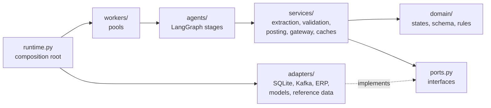
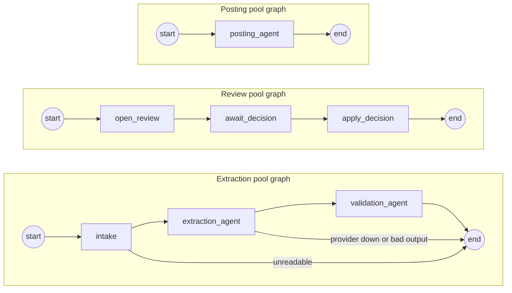
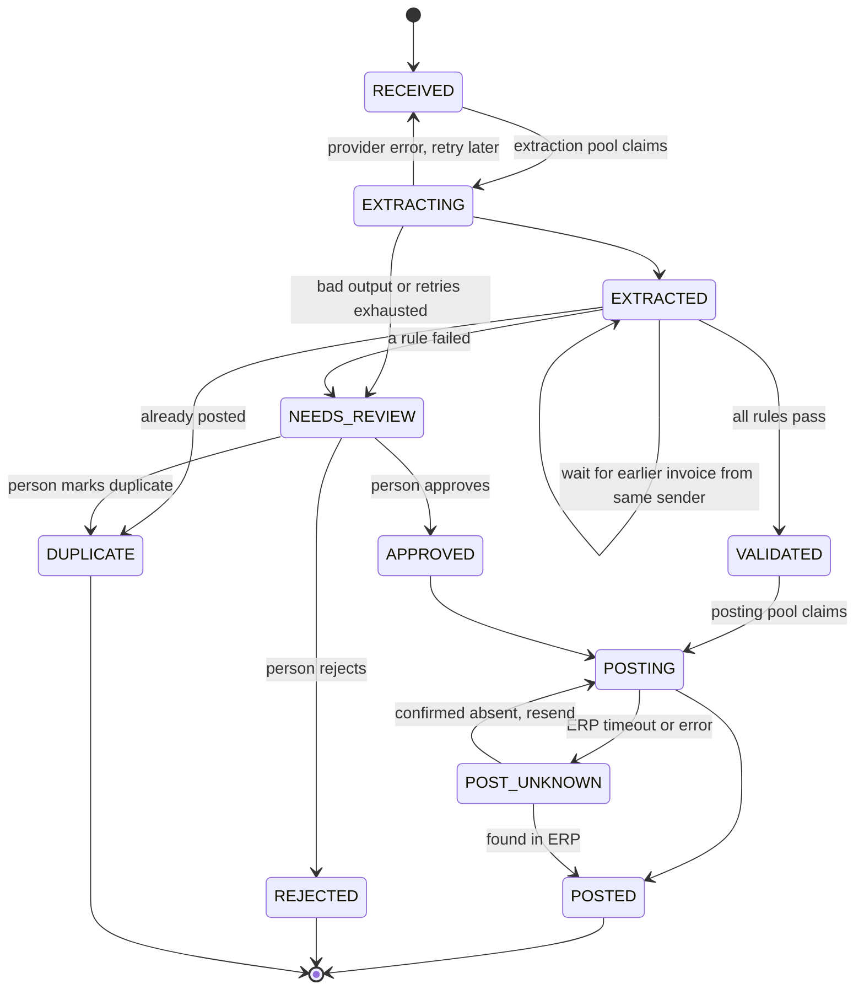

# Supplier Invoice Pipeline

An agent reads supplier invoice PDFs, checks them against business rules and posts them
to the ERP. Finance receives about 20,000 invoices a day, tripling at month-end.

Two goals outrank everything else:

- **Never pay a supplier twice.** Each invoice is posted to the ERP at most once.
- **Never lose an invoice.** Every invoice that arrives ends up posted, rejected, closed as a
  duplicate, or with a person.

Anything the agent is unsure about goes to a person.

This repository holds the design and a runnable reference implementation: LangGraph agents
running in parallel worker pools against a simulated Kafka topic, a mock ERP and switchable
models, with failures injected on purpose and every run scored against ground truth.

## Contents

1. [Rough numbers](#1-rough-numbers)
2. [Architecture](#2-architecture)
3. [Code structure](#3-code-structure)
4. [How invoices arrive](#4-how-invoices-arrive)
5. [The agents](#5-the-agents)
6. [Parallel processing](#6-parallel-processing)
7. [Caching](#7-caching)
8. [Invoice states](#8-invoice-states)
9. [Where state lives](#9-where-state-lives)
10. [Failure handling](#10-failure-handling)
11. [Why Postgres](#11-why-postgres)
12. [Models](#12-models)
13. [Running it](#13-running-it)
14. [Results](#14-results)
15. [Limits](#15-limits)

## 1. Rough numbers

Assumptions: 80% of invoices arrive in a 10-hour window, the peak hour is twice the average,
about 5,000 input and 1,000 output tokens per invoice, 90 seconds per human review.
`python run.py numbers` recomputes with different assumptions.

| Quantity | Normal day | Month-end day |
|---|---|---|
| Invoices | 20,000 | 60,000 |
| Peak arrival rate | ~0.9 per second | ~2.7 per second |
| Model tokens per day | ~120 M | ~360 M |
| Provider capacity needed at peak | ~0.35 M tokens/min, ~60 requests/min | ~1.1 M tokens/min, ~180 requests/min |
| Model calls in flight | ~10 to 40 | ~30 to 110 |
| Human review at 8% of invoices | ~40 hours (5 people) | ~120 hours (15 people) |
| PDF storage | ~6 GB | ~18 GB |
| Database writes at peak | ~10 per second | ~30 to 50 per second |

Raw throughput is easy for any database or queue. The real limits are **provider rate limits
at month-end** and **human review capacity**. Each stage is therefore its own worker pool,
sized to its own bottleneck.

## 2. Architecture



**How work moves.** Kafka is only the front door. The ingest pool turns each message into an
invoice row in Postgres. From there, Postgres is the work queue: each pool claims rows in its
own states, runs its LangGraph graph, and leaves the row in the next pool's state. Pools never
call each other.

| Pool | Default size | Scales on | Limited by |
|---|---|---|---|
| Ingest | 3 | Kafka consumer group, up to the partition count | Almost nothing |
| Extraction | 8 | Backlog size and age | Provider rate limits |
| Review | 4 | Open review tasks | People |
| Posting | 2 | Fixed | What the ERP tolerates |

## 3. Code structure

The code follows ports and adapters: business logic depends on interfaces, and only one
module (the composition root) knows the concrete classes.



| Layer | Folder | Depends on | Contents |
|---|---|---|---|
| Domain | `app/domain/` | nothing | Invoice states, extraction schema, normalisation, business rules |
| Ports | `app/ports.py` | domain | Interfaces: repository, message consumer, object store, model client, ERP, reference data, reviewer |
| Services | `app/services/` | domain, ports | Extraction, validation, posting, LLM gateway, caches |
| Agents | `app/agents/` | services, ports | One LangGraph graph per stage |
| Workers | `app/workers/` | agents, ports | Ingest, stage and review worker pools |
| Adapters | `app/adapters/` | ports | SQLite repository, Kafka simulator, mock ERP, model clients, cached reference data |
| Composition root | `app/runtime.py` | everything | Builds and wires all of the above |
| Simulation | `app/sim/` | domain | Dummy data generator, simulated reviewer |
| Evaluation | `app/eval/` | adapters | Scoring, scaling benchmark, report, capacity estimates |

How the SOLID principles show up:

| Principle | Where |
|---|---|
| Single responsibility | `ExtractionService` only turns text into fields; `ValidationService` only judges them; `PostingService` only posts; the gateway only handles provider behaviour |
| Open/closed | A business rule is a class with `check()`; add one to `default_rules()` without editing the validator. A model provider is one class plus one line in `build_model()` |
| Liskov substitution | `SimulatedModel`, `LangChainModel` and `LLMGateway` all satisfy the same `complete()` contract, so the extraction service takes any of them |
| Interface segregation | Small ports: the validator needs `ReferenceData` and two repository reads, not the whole database |
| Dependency inversion | Services import `app.ports`, never an adapter. Swapping SQLite for Postgres or the simulator for real Kafka changes `runtime.py` only |

## 4. How invoices arrive

The scenario starts at the topic; this section describes the assumed upstream.

| Channel | Notes |
|---|---|
| AP mailbox | Usually the largest share. One email can hold several invoices or none |
| Supplier portal | Uploads from larger suppliers |
| EDI / e-invoicing (Peppol, UBL) | Structured data; can skip the model entirely |
| Scanned paper | Smallest share, hardest to read |

Each adapter splits input into one invoice per message, stores the PDF in object storage,
and publishes a message with a pointer to the file plus channel metadata. Messages are keyed
by sender, so one supplier's invoices stay in order on one partition. The adapter
acknowledges the source only after Kafka confirms the write and never deletes source
emails. A daily count of received against published catches anything lost upstream.

The simulation puts the PDF bytes in the message instead of a pointer.

## 5. The agents

Each pool runs its own LangGraph graph. The supervisor across stages is the state machine
in Postgres; inside the extraction stage, conditional edges route between agents.



| Agent | Uses a model? | Job |
|---|---|---|
| `intake` | no | Load the PDF text (cached); unreadable files go to a person |
| `extraction_agent` | yes, no tools | Structured extraction through the gateway; one repair retry; grounding check |
| `validation_agent` | no | Business rules, duplicate check, per-sender ordering |
| `await_decision` | person | `interrupt()` pauses the graph until a reviewer answers |
| `posting_agent` | no | Outbox, idempotency key, look-up before any retry |

Rules for every node:

- **Only the extraction agent uses a model.** It returns data and cannot post anything. The
  model's own confidence never decides anything.
- **Every node reads the invoice's state first** and acts only if the row is where it
  expects. A node run twice, after a crash or by two workers, does nothing extra.

### Business rules

| Check | Fails when |
|---|---|
| Supplier match | Tax ID not in the vendor master, or name and tax ID disagree |
| Invoice number | Missing, is actually a PO or order number, or doesn't match the supplier's usual format |
| Grounding | Invoice number, tax ID, total or date isn't printed in the PDF |
| Arithmetic | Quantity × price ≠ line total; lines don't sum to subtotal; subtotal + tax ≠ total |
| Items match the PO | Item not on the PO, quantity above the PO, unit price more than 1% off |
| Currency and date | Currency differs from the supplier's; date in the future or older than 180 days |
| Bank details | IBAN differs from the vendor master (possible fraud) |
| Amount limit | Total above the auto-post limit (50,000 by default) |
| Duplicate | Same supplier and invoice number already posted, on its way to the ERP, or with a person |

## 6. Parallel processing

### Claiming work

A worker claims one row at a time with a lease: "this invoice is mine until time T". In
Postgres this is `SELECT … FOR UPDATE SKIP LOCKED`; here it is one `UPDATE … RETURNING`
under SQLite's write lock. A test runs 16 threads against 300 rows and checks that every row
is handed out exactly once.

| Event | What happens |
|---|---|
| Worker finishes | Releases the lease; the row is in the next pool's state |
| Worker crashes | Keeps the lease until it expires; another worker claims the row and **resumes the LangGraph run from its checkpoint** |
| Slow worker loses a race | Its conditional update matches nothing (`Conflict`); it drops the job |
| Row waiting for a retry or a person | `next_attempt_at` hides it from its pool until then |

### Shared limits at the gateway

All extraction workers share one gateway, so its limits are global, not per worker:

- **Token bucket** keeps every worker together under the agreed requests per minute. In
  production this bucket lives in Redis so it spans processes and machines.
- **Bulkhead** caps concurrent model calls, so a slow provider can't tie up every worker.
- **Circuit breaker per model** and failover to the fallback model.

### Ordering per sender

Kafka keeps one sender's invoices in order on one partition, but eight extraction workers
finish in any order. Without care, a re-sent copy with a different amount could be validated
before the original and paid instead.

So validation is ordered per sender while extraction stays fully parallel. An invoice waits
before validation only if an earlier invoice from the same sender could be the same invoice:
it hasn't been extracted yet, or it has the same invoice number. Waiting costs nothing but a
re-check, because the extraction result is cached.

### Scaling further in production

| Lever | Effect |
|---|---|
| More partitions (12 to 24) | Room to grow the ingest consumer group |
| Autoscale extraction on backlog age | Workers follow the month-end spike |
| Higher provider tier, second provider or region | Raises the hard ceiling |
| Provider batch API for non-urgent invoices | Separate, larger limits; cheaper |
| Process in order of payment due date | A backlog delays what can wait |
| Skip the model for EDI invoices | Fewer calls |
| Lease heartbeats | Long calls renew their lease instead of relying on a long lease time |
| Read replica for dashboards and reconciliation | Keeps reporting off the primary |

## 7. Caching

Cache only what is immutable or slow-changing and safe to be briefly stale.

| Cache | Key | Kind | Why |
|---|---|---|---|
| PDF text | File SHA-256 | In-process LRU | Retries, deferrals and crash recoveries don't re-parse the PDF |
| Vendor master and POs | Supplier, PO number | In-process TTL (5 min) | Read several times per invoice; change rarely. A short TTL still picks up bank-detail changes quickly |
| Extraction results | File hash + model + prompt version | Persisted in Postgres | A crash or re-run never pays for the same model call twice |
| Prompt prefix | Instructions + schema | Provider prompt cache | Identical on every call, so the provider charges about 10% for it and it counts less against limits |

Never cached, always read from the source of truth: invoice state, duplicate checks, and ERP
look-ups. A stale answer there is how double payments happen.

## 8. Invoice states



Every transition is a conditional update on state and version plus an audit event, in one
transaction.

## 9. Where state lives

| Store | Holds | If it is lost |
|---|---|---|
| Kafka | New-invoice messages, committed offsets | Replay from retention (keep at least 7 days) |
| Object store | PDFs by content hash, never modified | Durable by design |
| **Postgres** | Invoice states, leases, extraction results, outbox, review tasks, audit log | Source of truth. Synchronous standby and point-in-time recovery |
| Checkpoints | Where each workflow run got to; paused reviews | Rebuildable: restart open invoices from Postgres |
| Redis (production) | Shared rate-limit bucket, circuit-breaker state | Safe to lose; a brief burst of rate-limit errors |
| In-process caches | PDF text, reference data | Safe to lose; reloaded on demand |
| ERP | Posted invoices | External system of record, reconciled daily |

**Postgres holds what happened to each invoice; checkpoints hold only where a run was.**

| Table | Purpose |
|---|---|
| `invoice` | One row per unique PDF: state, version, lease, extracted fields, reasons. Unique on `doc_sha256`; partial unique index on `(supplier_id, invoice_no_norm)` for posting and posted rows |
| `extraction_cache` | Model responses by file, model and prompt version |
| `erp_outbox` | One entry per post: idempotency key, attempt count, ERP document ID |
| `review_task` | Open and decided reviews, with their own lease |
| `invoice_event` | Append-only audit log |
| `ingest_dlq` | Messages that couldn't be read, kept rather than dropped |

## 10. Failure handling

### Duplicates

| Layer | Example | Defence |
|---|---|---|
| Same message twice | Producer retry, consumer crash before acknowledging | Unique file hash; the second insert does nothing |
| Same invoice, new file | Supplier re-sends or rescans | Same supplier + invoice number already posted: closed as duplicate. Different amount, or the original is with a person: goes to a person |
| Same invoice posted twice | ERP timeout, then retry | Idempotency key; look-up before any retry; unique index refuses a second posting row |

### Bad model output

| Problem | Detection | Action |
|---|---|---|
| Invalid JSON or wrong shape | Schema validation | One retry with the error, then a person |
| Truncated answer | Stop reason is max tokens | Same as invalid output |
| Invented value | Not printed in the PDF text | A person, with the field flagged |
| Wrong but plausible value | Arithmetic, PO, supplier and currency checks | A person |

### Provider errors

| Error | Action |
|---|---|
| Rate limit (429) | Wait for Retry-After. The shared token bucket slows all workers before the provider has to |
| Timeout or server error | Exponential backoff with jitter |
| Repeated failures | Circuit breaker opens; calls go to the fallback model |
| Everything down | Invoice returns to RECEIVED with a later retry time; after 5 attempts it goes to a person |

### Crashes

| Crash point | Result |
|---|---|
| Ingest, before the row is saved | Not acknowledged, delivered again, processed once |
| Ingest, after the row, before acknowledging | Delivered again; insert does nothing |
| Extraction worker, after a model call | Lease expires; another worker resumes from the checkpoint; cached response reused |
| Posting worker, before the ERP call | Outbox shows an attempt started, so the next worker checks the ERP first |
| Posting worker, after the ERP call | The ERP check finds the post; marked posted, not resent |
| ERP timeout after the post landed | Marked uncertain; checked against the ERP after a settle window |

### Nothing lost

- Every message produces a row; unreadable ones go to `ingest_dlq`.
- Hourly: messages consumed against rows created.
- Alerts on any invoice stuck in one state past its time limit.
- Daily: posted invoices against ERP documents, both directions.
- A person checks a 1 to 2% sample of auto-posted invoices.

## 11. Why Postgres

Every guarantee that prevents a double payment or a lost invoice should be enforced by the
database, not only by application code.

| Requirement | Postgres feature |
|---|---|
| Never post the same invoice twice | Partial unique index on supplier + invoice number |
| State change and outbox entry together | Transactions across several rows |
| Two workers can't both advance one invoice | Conditional update on state and version |
| Each invoice to exactly one worker, no extra queue | `SELECT … FOR UPDATE SKIP LOCKED` with a lease |
| Prove nothing was lost | SQL joins across invoices, outbox, reviews and ERP exports |
| Flexible model output | `JSONB` columns |

| Alternative | Why not chosen |
|---|---|
| MongoDB | Same guarantees possible, but each must be deliberately used; the work queue and reconciliation need extra code |
| DynamoDB | No joins; uniqueness on supplier + invoice number needs a separate lock-item pattern |
| Kafka as the state store | No uniqueness rule across keys |
| Temporal | Tracks workflow progress well; uniqueness and reporting still need a database |

At about 50 writes per second at peak, load doesn't decide the choice. What decides it is
that in Postgres the safe way to write is the normal way.

## 12. Models

Defined in `models.json`; chosen with `--model` and `--fallback`, or `INVOICE_MODEL` and
`INVOICE_FALLBACK`.

| Name | Kind | Behaviour |
|---|---|---|
| `sim-strong` | Simulated | Rare mistakes, slower, more expensive |
| `sim-fast` | Simulated | Cheap and fast, more extraction slips |
| `sim-weak` | Simulated | Frequent bad JSON and invented values |
| `sim-flaky` | Simulated | Good model behind an unreliable provider |
| `claude-sonnet`, `claude-haiku` | Real | `langchain-anthropic`, needs `ANTHROPIC_API_KEY`; system prompt marked for prompt caching |
| `openai-mini` | Real | `langchain-openai`, needs `OPENAI_API_KEY` |

Simulated models read the PDF text correctly, then make mistakes at the rates in
`models.json`. They show how the pipeline handles an error profile; they are not benchmarks
of real models.

## 13. Running it

```bash
pip install -r requirements.txt

python run.py numbers                          # capacity estimates
python run.py models                           # list models
python run.py gen --n 400                      # dummy invoices, vendor master, purchase orders
python run.py run --model sim-fast --extraction 16 --chaos default
python run.py eval --chaos heavy               # all models + naive poster + scaling -> runs/report.html
python run.py scale --workers 1,2,4,8,16,32    # throughput vs extraction workers
python -m pytest -q tests                      # safety and design tests
```

| Option | Meaning |
|---|---|
| `--chaos none/default/heavy` | How much failure is injected. Heavy: 15% producer duplicates, 10% consumer crashes, 10% worker crashes, 15% ERP timeouts after posting, 10% ERP errors |
| `--ingest/--extraction/--review/--posting N` | Pool sizes |
| `--rpm N` | Model requests per minute across all workers |

Workers really run in parallel threads. Time is scaled (by default 1 simulated second =
4 ms) so a 9-second model call or a 90-second review is fast to replay, while leases,
backoff and rate limits behave as they would in real time.

### Simulated systems

| File in `runs/<run>/` | Stands in for |
|---|---|
| `kafka_broker.db` | Kafka partitions and committed offsets |
| `object_store/` | S3 or GCS |
| `invoices.db` | Postgres |
| `langgraph_checkpoints.db` | LangGraph checkpoint store (Postgres checkpointer in production) |
| `erp.db` | The ERP |

## 14. Results

### Models, heavy chaos

400 invoices, seed 42, pools of 3 / 8 / 4 / 2. About a quarter of the invoices contain
planted problems.

| Model | Double payments | Lost | Wrong auto-posts | Auto-posted | To review | $/invoice |
|---|---|---|---|---|---|---|
| sim-strong | 0 | 0 | 0 | 70.2% | 24.5% | 0.0042 |
| sim-fast | 0 | 0 | 0 | 64.0% | 32.0% | 0.0011 |
| sim-weak | 0 | 0 | 0 | 56.2% | 39.2% | 0.0004 |
| sim-flaky | 0 | 0 | 0 | 65.8% | 29.2% | 0.0017 |
| sim-strong, naive poster | **101** | 0 | 0 | 71.2% | 23.2% | 0.0041 |

The naive poster retries a timed-out ERP post without checking whether it landed. That one
change produces 101 double payments.

### Scaling the extraction pool

All 400 invoices queued at once, a shared limit of 120 model requests per minute, default
chaos.

| Extraction workers | Invoices per hour | Backlog drained | Calls in flight | Throttled | Double pay / lost |
|---|---|---|---|---|---|
| 1 | 287 | 83.5 min | 1 | 0 s | 0 / 0 |
| 2 | 506 | 47.5 min | 2 | 0 s | 0 / 0 |
| 4 | 857 | 28.0 min | 4 | 0 s | 0 / 0 |
| 8 | 1,272 | 18.9 min | 8 | 0 s | 0 / 0 |
| 16 | 1,681 | 14.3 min | 16 | 0 s | 0 / 0 |
| 32 | 1,780 | 13.5 min | 27 | 850 s | 0 / 0 |

Throughput grows with workers. Beyond 8 the gains shrink: the last invoices of each
sender wait for earlier ones, and retries after provider errors form a tail. At 32 workers
the shared rate limit starts holding calls back, so more workers only add waiting. That's
the point to buy a higher provider tier rather than more workers.

### Caching, sim-strong run

| Cache | Effect |
|---|---|
| Reference data | 93% hit rate; 82 reads reached the source instead of about 1,190 |
| Extraction results | 47 model calls avoided after crashes |
| Prompt prefix | About 185,000 prompt tokens served from the provider cache, cutting model spend by about 23% |

## 15. Limits

- The simulated reviewer always decides correctly, so final outcomes are right by
  construction once a person sees an invoice. The meaningful numbers are what was
  auto-posted and how much went to review.
- Workers are threads in one process sharing SQLite. Production would run separate
  processes against Postgres with the rate-limit bucket in Redis; the claim, lease and
  conditional-update logic is the same.
- The time scaling adds a small fixed overhead per job, which slightly flattens the scaling
  curve at high worker counts.
- Not modelled: OCR for scanned PDFs, the review UI, upstream intake adapters.
- Real models are wired in but were not run here; run
  `python run.py eval --models claude-sonnet,claude-haiku` with an API key to score them.
